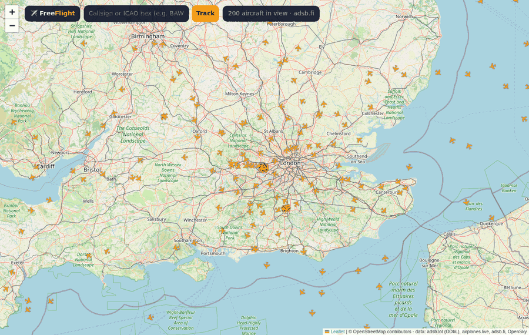
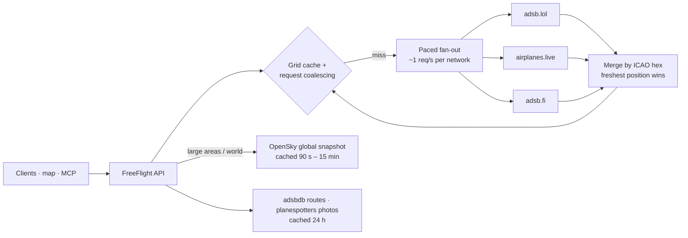

<div align="center">

# ✈️ FreeFlight API

**A free, self-hosted live flight tracking API. No API key, no quotas, no credit card.**

FreeFlight merges three volunteer ADS-B receiver networks (adsb.lol, airplanes.live and adsb.fi) with the OpenSky Network's global snapshot, and serves them through one clean JSON API.<br>
It also gives you flight routes, aircraft details, photos, a live map, a streaming feed, OpenSky- and ADSBExchange-compatible endpoints, and an MCP server for AI agents.

[](https://github.com/Ethos6/free-flight-api/actions/workflows/ci.yml)
[](https://github.com/Ethos6/free-flight-api/releases)
[](https://github.com/Ethos6/free-flight-api/actions/workflows/provider-health.yml)
[](LICENSE)


[Quick start](#-quick-start) · [Endpoints](#-endpoints) · [Live map](#%EF%B8%8F-live-map) · [Drop-in compatibility](#-drop-in-replacement) · [MCP](#-mcp-server-for-ai-agents) · [How it works](#-how-it-works) · [Coverage & limits](#-coverage-honest-numbers)



<sub>Recorded automatically by the <a href="https://github.com/Ethos6/free-flight-api/actions/workflows/demo.yml">Demo GIF workflow</a>: live aircraft from the ADS-B networks, a track popup, then all of Europe.</sub>

</div>

---

```bash
docker run -d -p 8000:8000 ghcr.io/ethos6/free-flight-api:latest
curl "http://localhost:8000/v1/flights/nearby?lat=51.47&lon=-0.45&radius_nm=30"
```

```jsonc
{
  "count": 87,
  "aircraft": [
    {
      "hex": "406b0f", "callsign": "BAW117", "registration": "G-XWBA", "type": "A35K",
      "lat": 51.4701, "lon": -0.905, "altitude_ft": 12025, "altitude_m": 3665,
      "ground_speed_kt": 311.0, "speed_kmh": 576.0, "track": 265.1, "vertical_rate_fpm": 1984,
      "squawk": "2301", "on_ground": false, "military": false, "position_source": "adsb",
      "seen_pos_s": 0.1, "distance_nm": 17.9, "providers": ["adsb.fi", "adsb.lol", "airplanes.live"]
    }
  ],
  "providers": [ { "name": "adsb.lol", "ok": true, "aircraft": 90, "elapsed_ms": 212 }, "…" ],
  "cached": false
}
```

## Why?

| | Price | Limits | Self-hosted | Open source |
|---|---|---|---|---|
| FlightAware AeroAPI, FlightRadar24 API | paid per query or subscription | quotas | ❌ | ❌ |
| Calling one ADS-B network directly | free | about 1 request/second, one network's coverage | – | – |
| **FreeFlight API** | **free** | **none imposed by the software**; clients share cached upstream calls | ✅ | ✅ **MIT** |

## ✨ Features

- **Three networks merged.** Each aircraft is matched by its ICAO address across networks. The freshest position wins, and gaps (registration, type, callsign) are filled in from the others, so you get better coverage than any single network.
- **World snapshot.** `/v1/flights/world` returns every aircraft OpenSky is tracking worldwide (typically 10,000–13,000 aircraft), cached so it stays within OpenSky's free credit budget.
- **Polite by design.** Each network gets its own request pacing (about 1 req/s), with a circuit breaker on 429 or 5xx errors and automatic failover. Requests are coalesced and grid-cached, so 1,000 clients looking at the same area cost one upstream call.
- **Flight lookups:** callsign, ICAO hex, registration, aircraft type, military, squawk, and emergencies (7500/7600/7700).
- **`/v1/track/{callsign}`** returns the live position, origin and destination airports and airline (from [adsbdb](https://www.adsbdb.com)), aircraft owner and model, and a photo (from [planespotters.net](https://www.planespotters.net)).
- **Streaming.** `/v1/stream/nearby` is a Server-Sent Events feed that pushes a fresh snapshot every few seconds.
- **Filters:** altitude, on-ground, military, aircraft type, and limit.
- **Units:** both aviation and metric (ft and m, kt and km/h).
- **Live map** at `/`, built with Leaflet. Click any plane for its route and photo, or search by callsign.
- **Drop-in replacement** for the **OpenSky REST API** and the **ADSBExchange v2 / adsb.lol** API.
- An **MCP server**, a **CLI**, **Docker**, and optional **API keys and rate limiting**.

## 🚀 Quick start

```bash
# Docker (one command)
docker run -d -p 8000:8000 ghcr.io/ethos6/free-flight-api:latest

# or from source
git clone https://github.com/Ethos6/free-flight-api && cd free-flight-api && docker compose up -d

# or pip
pip install "free-flight-api[mcp] @ git+https://github.com/Ethos6/free-flight-api"
freeflight serve
```

Open **http://localhost:8000** for the live map, or **/docs** for the interactive API.

**CLI:**

```bash
freeflight nearby 40.64 -73.78 -r 25        # planes around JFK
freeflight track BAW117                     # live position + route + aircraft + photo
freeflight world                            # how many aircraft are flying right now
freeflight check                            # health table for every data network
```

## 📡 Endpoints

| Endpoint | Description |
|---|---|
| `GET /v1/flights/nearby?lat=&lon=&radius_nm=` | Aircraft within a radius (≤ 250 nm), sorted by distance |
| `GET /v1/flights/bbox?lamin=&lomin=&lamax=&lomax=` | Aircraft in a bounding box. Small boxes use the live networks; large ones use the world snapshot |
| `GET /v1/flights/world` | Every aircraft tracked worldwide (OpenSky, cached) |
| `GET /v1/flights/military` | Military aircraft |
| `GET /v1/flights/emergencies` | Aircraft squawking 7500, 7600 or 7700 |
| `GET /v1/flights/squawk/{code}` · `/v1/flights/type/{A388}` | Filter by squawk code or ICAO type |
| `GET /v1/callsign/{BAW117}` · `/v1/aircraft/{hex}` · `/v1/registration/{G-XWBA}` | Live lookups |
| `GET /v1/track/{callsign or hex}` | Live position, route, aircraft details and photo |
| `GET /v1/route/{callsign}` · `/v1/aircraft/{hex}/info` | Route only, or aircraft details only |
| `GET /v1/stream/nearby?lat=&lon=&interval=5` | Live Server-Sent Events stream |
| `GET /v1/providers` | Per-network health: success rate, latency, cooldown |

**Filters** work on every list endpoint: `min_alt`, `max_alt` (feet), `on_ground`, `military`, `type=A320,B738`, and `limit`.

## 🗺️ Live map

`http://localhost:8000` opens a full-screen live map. When you zoom in, it shows rotated plane icons that refresh every 8 seconds. When you zoom out to a continent or the whole world, it switches to a fast dot view. Click a plane to see its route, aircraft type, registration and a photo. The search box finds any callsign or ICAO hex.

## 🔁 Drop-in replacement

| Existing code for | Point it at | Works |
|---|---|---|
| **OpenSky REST API** | `http://your-server:8000/api` | `GET /states/all` with `lamin/lomin/lamax/lomax` or `icao24`. Same 17-field state vectors, with SI units |
| **ADSBExchange v2 / adsb.lol / airplanes.live** | `http://your-server:8000/v2` | `/point/{lat}/{lon}/{nm}`, `/hex/`, `/callsign/`, `/reg/`, `/type/`, `/mil`, `/sqk/`. Same `ac[]` records |

So tar1090-style tools, OpenSky scripts and existing ADS-B dashboards can use FreeFlight without code changes.

## 🤖 MCP server for AI agents

```json
{ "mcpServers": { "freeflight": { "command": "freeflight", "args": ["mcp"] } } }
```

This gives your assistant four tools: `flights_near`, `track_flight`, `emergencies` and `military_aircraft`. You can then ask things like *"What's flying over my house right now?"* or *"Where is BA117 and when did it leave London?"*

## 🧠 How it works



1. **Grid cache.** A request is snapped to a 0.25° grid and a fixed set of radius sizes, so nearby users share the same upstream request. Results are then filtered to each user's exact circle.
2. **Coalescing.** If 1,000 identical requests arrive at once, they wait for one upstream call.
3. **Pacing and circuit breaking.** No network is called more than about once per second. A network that returns 429 or errors cools down while the others keep answering.
4. **Merge.** Records are de-duplicated by ICAO address, the freshest position is kept, and missing fields are filled from the other networks.

## 📊 Coverage: honest numbers

- **Where coverage comes from.** Live data comes from thousands of volunteer ADS-B and MLAT receivers. Coverage is excellent over North America, Europe, and much of Asia and Oceania. It is patchy over oceans, polar regions and parts of Africa, because there are no ground receivers there.
- **What gets tracked.** Aircraft are tracked when they carry an ADS-B or Mode-S transponder that a receiver can hear. That covers virtually all airliners and most business jets and general aviation. Gliders and aircraft without transponders may be missing.
- **The world snapshot.** `/v1/flights/world` is OpenSky's global view. Anonymous access gets about 100 global queries per day, so FreeFlight refreshes it every 15 minutes by default. Create a free OpenSky API client and set `FREEFLIGHT_OPENSKY_CLIENT_ID` and `FREEFLIGHT_OPENSKY_CLIENT_SECRET` to refresh it every 90 seconds.
- **Some networks restrict datacenter IPs.** In our GitHub Actions check, adsb.fi and OpenSky answered (12,063 aircraft in the world snapshot) while airplanes.live returned 403 and adsb.lol timed out from GitHub's cloud runners. From home and residential connections all networks normally work. FreeFlight fails over automatically, so you get the networks that are reachable from your server.
- **Daily health check.** The [Provider health](https://github.com/Ethos6/free-flight-api/actions/workflows/provider-health.yml) workflow queries every network from a GitHub runner and posts the results.

## ⚖️ Data sources & terms

FreeFlight is a client. The data belongs to the networks that collect it. Please respect their terms and support them, ideally by [feeding](https://adsb.lol) a receiver.

| Source | Used for | Terms |
|---|---|---|
| [adsb.lol](https://adsb.lol) | live positions | ODbL 1.0 (open data, attribution) |
| [airplanes.live](https://airplanes.live) | live positions | non-commercial use |
| [adsb.fi](https://adsb.fi) | live positions | non-commercial use, attribution |
| [OpenSky Network](https://opensky-network.org) | world snapshot | non-commercial research use; commercial licenses available |
| [adsbdb](https://www.adsbdb.com) | routes and aircraft details | free API |
| [planespotters.net](https://www.planespotters.net) | photos (credited) | photographer credit and link required |

For commercial use, get a commercial license from the providers, or switch networks off with `FREEFLIGHT_PROVIDERS` and `FREEFLIGHT_OPENSKY=false`.

## ⚙️ Configuration

See [`.env.example`](.env.example).

| Variable | Default | |
|---|---|---|
| `FREEFLIGHT_PROVIDERS` | `adsb.lol,airplanes.live,adsb.fi` | Networks to merge |
| `FREEFLIGHT_OPENSKY` | `true` | World snapshot and large areas |
| `FREEFLIGHT_OPENSKY_CLIENT_ID` / `_SECRET` | – | Free OpenSky API client for 10× more world refreshes |
| `FREEFLIGHT_WORLD_TTL` | auto | World refresh interval in seconds |
| `FREEFLIGHT_CACHE_TTL` | `5` | How long area results are shared between clients |
| `FREEFLIGHT_PHOTOS` | `true` | Fetch photos from planespotters.net |
| `FREEFLIGHT_API_KEYS` / `FREEFLIGHT_RATE_LIMIT` | – / `0` | Protect a public server |

## 🛠 Development

```bash
pip install -e ".[dev]"
pytest              # offline: every upstream is mocked from fixtures
ruff check .
freeflight check    # live check from your machine
```

PRs are welcome, especially new data networks, airport and airline databases, and map features.

## 📄 License

[MIT](LICENSE). If FreeFlight is useful to you, **please ⭐ star the repo** and consider feeding ADS-B data to one of the networks.

See also: [FreeSearch API](https://github.com/Ethos6/free-search-api) · [FreeNews API](https://github.com/Ethos6/free-news-api)
